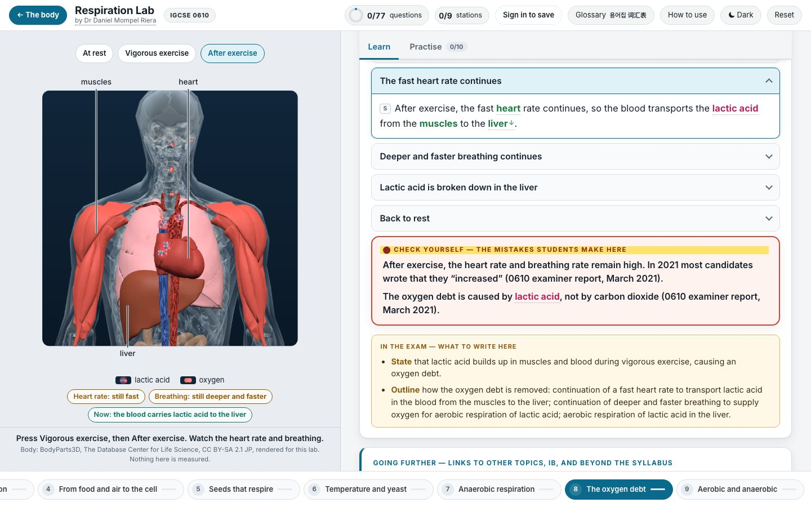

<h1>⚡ &nbsp;Respiration Lab</h1>

**Cambridge IGCSE Biology 0610 · Topic 12, Respiration**

by **Dr Daniel Mompel Riera**

---

## What a student does

Each station has its own picture on the left and short cards on the right that open one at a time. Open a card and its part
shows in the picture. The stations follow the Topic 12 lessons and revision summary, in their order and in their words. Then
the questions say right or wrong, never the answer.

|  |  |
|---|---|
| ⚡ **9 stations** | what respiration is · the uses of energy · aerobic respiration · from food and air to the cell · seeds that respire · temperature and yeast · anaerobic respiration · the oxygen debt · aerobic and anaerobic |
| ✍️ **77 questions** | fill the gaps · multiple choice · put in order · match up · sort into groups · tick a grid · drag the words |
| 🧍 **One real body** | a body from medical scans: follow glucose, oxygen, carbon dioxide and water along their routes |
| 🔋 **Seven uses of energy** | a moving picture for each use, fed by a mitochondrion |
| ⚛️ **Count the atoms** | the atoms of the balanced equation come apart and join again, the same number on each side |
| 🎬 **Step by step** | aerobic respiration in a cell; yeast and muscle without oxygen; the oxygen debt |
| 🎥 **Real films** | the mitochondria of a living cell, a single heart muscle cell beating, a seedling growing |
| 🌡️ **Two benches** | germinating and boiled seeds in vacuum flasks; yeast with a blue dye at four temperatures |
| 🟡 **A Venn diagram** | Dr Mompel's own diagram of aerobic and anaerobic respiration, to complete |
| 📖 **A shared glossary** | one wording per term, the same in every lab; press 한국어, 中文 or 日本語 to see each word's name in Korean, Chinese or Japanese (the definitions stay in English) |

> [!NOTE]
> **The right answers are stored only as scrambled fingerprints.** The lab can tell a student they are wrong, but its
> questions cannot show what *right* is. The explanations of the multiple-choice options are published with the lab,
> scrambled, for the pupils whose teacher gives them the Accommodation: each sees an explanation after a second wrong try.
> Someone who unscrambles them could learn an answer.

## Where it sits

Behind [The human body](https://nlcsbiology.com/human-body-hub/) shelf (Topic 12), one shelf of the
[Biology Hub](https://nlcsbiology.com/biology-hub/) — the front door to every Biology app here. The **← The body** button
goes back up. Breathing is in the [Gas Exchange Lab](https://nlcsbiology.com/gas-exchange-lab/), the heart and the blood are in
the [Circulation Lab](https://nlcsbiology.com/circulation-lab/), and active transport is in the
[Membrane Lab](https://nlcsbiology.com/membrane-lab/).

<b>Behind the scenes</b> — how this lab works, in plain English

 

**Real pictures.** The body is one real human body, measured by medical scanners and published as BodyParts3D. The films are
real recordings, and each is credited under it. The molecules and cells are drawn for this lab, so that one molecule always
looks the same. The list of every picture and film is in [`assets/photos/CREDITS.md`](assets/photos/CREDITS.md).

**True at every frame.** Glucose never enters a mitochondrion: it is split in the cytoplasm first. The number of molecules
always agrees with the equation. Where the syllabus simplifies, the lab keeps the syllabus's words and says what is beyond them.

---

The software is under the GNU AGPL v3.0 ([LICENSE](LICENSE)), the teaching material under CC BY-NC-SA 4.0
([LICENSE-CONTENT](LICENSE-CONTENT)). Third-party pictures and films keep their own licences ([credits](assets/photos/CREDITS.md)).
Questions or corrections: <a href="mailto:dmompelriera@nlcsjeju.kr">dmompelriera@nlcsjeju.kr</a>.
